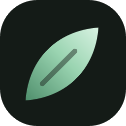

<p align="center">
  
</p>

<h1 align="center">Moss</h1>

<p align="center"><b>Discord, softened.</b><br>
A calm Discord desktop app with smooth animations, your own colours, and the tools Discord should have had built in.</p>

<p align="center">
  <a href="https://github.com/mosscord/moss/releases/latest"><b>Download for Windows</b></a>
</p>

---

## What you get

**Your look, set up on first launch**
- A short setup the first time you log in: language, colours, animations, plugins and startup options. Everything applies live, so you see it change behind the setup window.
- Three colour modes: the Moss greens, Discord's own colours (Nitro themes included), or your own solid colour or gradient.
- Five animation styles (Smooth, Snappy, Playful, Minimal, Off), each with a live preview, and switches for each area of the app.
- A welcome screen and a 30-second tour of what Moss adds.

**Server manager**
- See every server you're in with its icon, member count and when you last opened it.
- Select the ones you don't use and leave them in one go, with a safe delay between each one.
- Mark selected servers as read, or mute and unmute them.
- Left one by mistake? It stays under **Recently left** for 30 days with a Join button.

**Quick actions** (the button at the top of your server list)
- Mark every server or every DM as read.
- Mute all servers for 1 hour, 8 hours, 24 hours or until you turn them back on. Moss only unmutes the servers it muted.
- Switch every server to @mentions only, or hide @everyone and @here pings everywhere.

**Focus mode**
- One click or <kbd>Ctrl</kbd>+<kbd>Shift</kbd>+<kbd>F</kbd>: Do Not Disturb, no member list and no Active Now, for a set time or until you end it. Your old status comes back afterwards.

**Catch up**
- Right click a channel or DM, or press <kbd>Alt</kbd>+<kbd>C</kbd>, for a short AI summary of what you missed.
- Uses a free [OpenRouter](https://openrouter.ai/keys) API key. The setup shows you how to get one.

**Bookmarks**
- Drag any channel or DM onto the bar at the top to pin it there.

**And the rest**
- 20 plugins ready to go: platform indicators, permissions viewer, translate, message logger, voice messages, timezones, music controls and more. Hundreds more can be switched on in Settings.
- 11 languages: English, Spanish, French, German, Portuguese (Brazil), Italian, Dutch, Polish, Turkish, Russian and Japanese.
- Automatic updates. New versions download in the background and install when you restart.

## Install

1. Download the **Moss-Setup** `.exe` from the [latest release](https://github.com/mosscord/moss/releases/latest).
2. Run it. Windows may show *"Windows protected your PC"* because the installer isn't code-signed. Click **More info**, then **Run anyway**.
3. The installer asks whether Moss should start with Windows, and whether to stop the regular Discord app from starting too. Both can be changed later.
4. Log in with your Discord account as usual. The setup opens right after.

To uninstall, use **Settings → Apps** in Windows. If Moss turned off Discord's startup entry, uninstalling turns it back on.

## Build it yourself

Moss comes in two parts: this app, and [moss-core](https://github.com/mosscord/moss-core), the part that runs inside Discord. Clone both side by side:

```sh
git clone https://github.com/mosscord/moss-core moss
git clone https://github.com/mosscord/moss moss-desktop
```

Then build the core first and the app second. You need [Node.js](https://nodejs.org), [pnpm](https://pnpm.io) and [Bun](https://bun.sh).

```sh
cd moss
pnpm install --frozen-lockfile
pnpm build --standalone --disable-updater

cd ../moss-desktop
bun install
bun run build
bunx electron-builder --win nsis --x64 --publish never
```

The installer ends up in `moss-desktop/dist`.

## Good to know

Moss is not made by or affiliated with Discord. Like every modified Discord client, it goes against Discord's Terms of Service, so use it at your own risk. Bulk actions such as leaving or muting servers go one at a time with a delay, so Moss never hammers Discord with requests.

## Licence

Moss is free software under the [GPL-3.0-or-later](LICENSE) licence. It's built on the open-source projects Equibop and Equicord, which build on Vesktop and Vencord.
